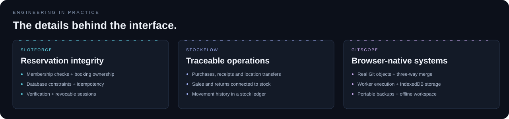
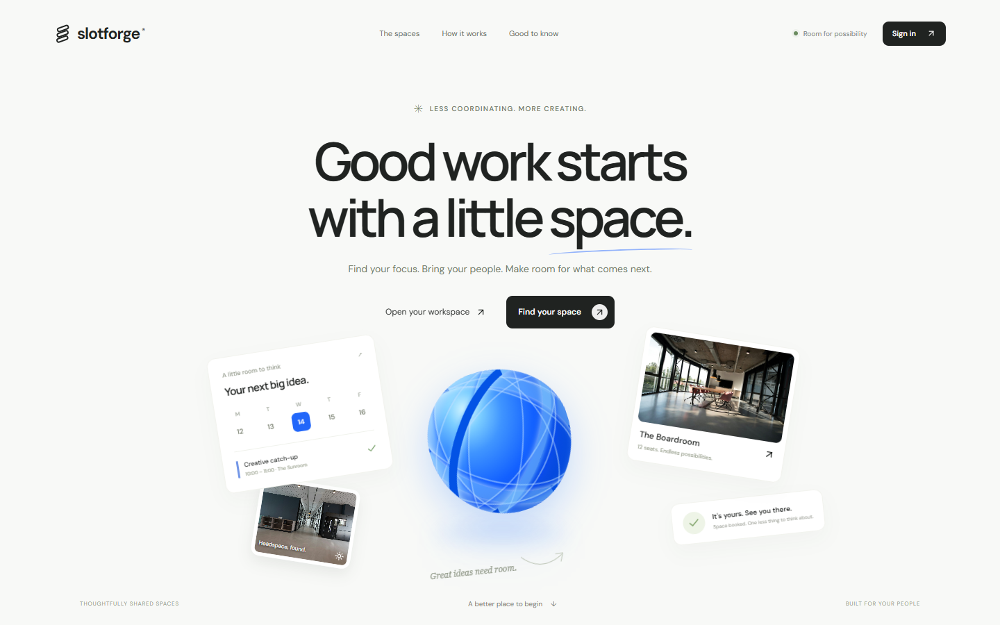
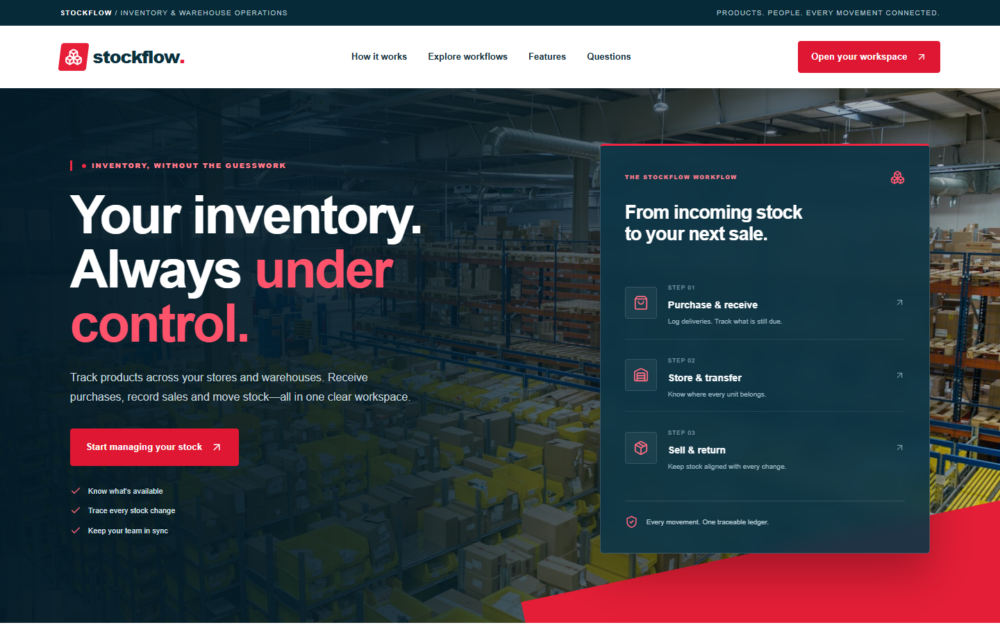
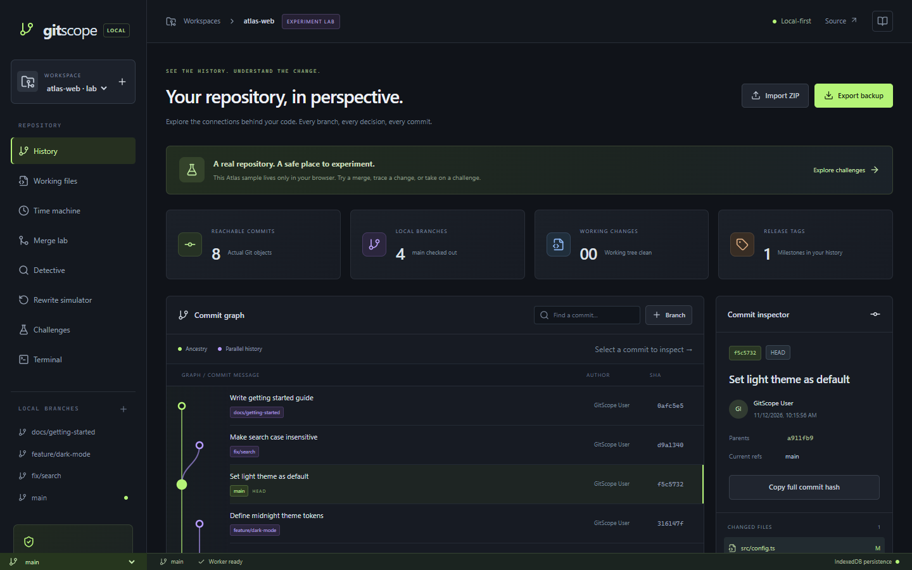

<a href="#featured-projects">PROJECTS</a> &nbsp; / &nbsp; <a href="#tech-arsenal">TECH STACK</a> &nbsp; / &nbsp; <a href="#where-i-have-contributed">EXPERIENCE</a> &nbsp; / &nbsp; <a href="#milestones-along-the-way">MILESTONES</a>

## About me

I build web applications that connect **a clear interface to a dependable backend**. I enjoy the whole journey: understanding a problem, designing the data, writing the API and making the final interaction feel right.

From **product teams and client applications to developer tools**, I like working on the details that make software useful: handling competing bookings, tracing inventory changes and keeping local work safe after a refresh.

**Based in Indore, India. Building with React, TypeScript and Node.js.**

### Current focus

- 🧱 **At work:** full-stack product development at BlueBricks Technologies.
- 🛠️ **In my projects:** reservations, inventory workflows and browser-local Git tools.
- 🔎 **My engineering focus:** data integrity, permissions and useful error states.
- 🤝 **Let's talk about:** full-stack roles, product engineering and thoughtful web experiences.

 

---

## Engineering in practice

| Engineering concern | Implementation to explore |
| :--- | :--- |
| **Authorization & safe retries** | [SlotForge](https://github.com/aadi90392/slotforge): workspace membership, booking ownership and idempotency |
| **Consistency under competing requests** | [SlotForge](https://github.com/aadi90392/slotforge): reservation rules protected by database constraints |
| **Operational traceability** | [StockFlow](https://github.com/aadi90392/stockflow): receiving, transfers, sales and returns connected to inventory history |
| **Work off the main thread** | [GitScope](https://github.com/aadi90392/gitscope): Git operations executed through a Web Worker |
| **Local persistence & recovery** | [GitScope](https://github.com/aadi90392/gitscope): IndexedDB filesystem, flush-before-acknowledgment and portable backups |

## Featured Projects

**Built, deployed and ready to explore.** Each preview below comes from the actual live application. Click a screenshot to inspect its source, or launch the app using the links below it.

### 01 / SlotForge

Shared rooms. Clear permissions. Bookings that stay consistent.

React · TypeScript · Cloudflare Workers · D1

**[Launch SlotForge ↗](https://slotforge.aditya-upadhyay1-dev.workers.dev/)** &nbsp; / &nbsp; [Source code](https://github.com/aadi90392/slotforge) &nbsp; / &nbsp; [Project overview](https://portfolio.aditya-upadhyay1-dev.workers.dev/#slotforge)

<b>Inside SlotForge — protect a booking beyond the button</b>

- **Membership-based access:** workspace roles and booking ownership are checked on the backend.
- **Competing reservations:** database constraints protect the booking rules.
- **Safe retries:** idempotency handling keeps repeated requests from becoming duplicate operations.
- **Account lifecycle:** email verification, recovery and revocable sessions.
- **Deliberate boundary:** physical room reservations, not a video meeting service.

 
### 02 / StockFlow

Know what is in stock, where it belongs and how it got there.

React · TypeScript · Hono · Cloudflare D1

**[Launch StockFlow ↗](https://stockflow.aditya-upadhyay1-dev.workers.dev/)** &nbsp; / &nbsp; [Source code](https://github.com/aadi90392/stockflow) &nbsp; / &nbsp; [Project overview](https://portfolio.aditya-upadhyay1-dev.workers.dev/#stockflow)

<b>Inside StockFlow — connect operations to inventory</b>

- **One workspace:** products, suppliers, locations and team access.
- **Connected operations:** purchases, receiving, transfers, sales and returns.
- **Traceable changes:** a stock ledger helps explain inventory movements.
- **Deployment:** a React interface and Hono API on Cloudflare, backed by D1.
- **Deliberate boundary:** inventory operations, not shipment tracking or a complete accounting suite.

 
### 03 / GitScope

See your Git history. Resolve conflicts. Explore safely in your browser.

React · TypeScript · Web Workers · isomorphic-git · IndexedDB

**[Launch GitScope ↗](https://aadi90392.github.io/gitscope/)** &nbsp; / &nbsp; [Source code](https://github.com/aadi90392/gitscope) &nbsp; / &nbsp; [Architecture & boundaries](https://github.com/aadi90392/gitscope#architecture)

<b>Inside GitScope — Git objects, workers and persistence</b>

- **Real repository operations:** commits, branches, staging and merges through isomorphic-git.
- **Three-way resolution:** inspect base, current and incoming versions before producing a merge commit.
- **Responsive processing:** Git operations run in a Web Worker; LightningFS persists objects in IndexedDB.
- **Reload reliability:** filesystem writes are flushed before completed operations are acknowledged.
- **Deliberate boundary:** local repositories; no remote push/clone. History rewrite tools are explicitly simulations.

[Read the implementation and verification approach →](https://github.com/aadi90392/gitscope#verification)

---

## Where I have contributed

| Team | Role | Focus |
| :--- | :--- | :--- |
| **BlueBricks Technologies** · Jul 2026–present | Full Stack Developer | NestJS / Next.js product features, technical evaluations and performance investigation |
| **Vosyn** · Jan–Jun 2026 | Junior Software Developer · Pod Ceres Lead | React / Node.js delivery, pull-request reviews and cross-team quality |
| **Kodrish** · Jan 2025–Jan 2026 | Web Developer | Client-facing MERN applications, REST APIs and deployment |
| **Infotact** · Sep–Nov 2024 | Associate Lead Developer · Intern | Team delivery and MongoDB schema improvements |

[Explore responsibilities and outcomes on my portfolio →](https://portfolio.aditya-upadhyay1-dev.workers.dev/#experience)

## Tech arsenal

### Interfaces & interaction

### APIs & data

### Build, verify & ship

 

<b>View the complete toolkit</b>

| Build the interface | Connect the system | Keep the data dependable |
| :--- | :--- | :--- |
| **React · Next.js · TypeScript** | **Node.js · NestJS · Express** | **PostgreSQL · MongoDB · MySQL** |
| Tailwind CSS · HTML · CSS | REST APIs · JWT · RBAC · Hono | Redis · Cloudflare D1 · IndexedDB |
| Zustand · D3 · Monaco Editor | Web Workers · isomorphic-git | Git · GitHub Actions · Cloudflare |

<b>🧰 Explore how I use these tools</b>

**Frontend development** — Component-driven interfaces, forms, responsive layouts and explicit loading, empty and failure states. D3 and Monaco support the graph and code-editing experience in GitScope.

**Backend development** — API design, input validation, authentication and authorization. Important rules belong on the server and at the data layer, not just in a disabled button.

**Data and persistence** — Relational models for operational workflows, MongoDB for document-oriented applications, and IndexedDB for browser-local repositories.

**Testing and delivery** — Vitest for behavior checks, Playwright for browser flows, Postman for API inspection, and GitHub Actions for repeatable checks and deployments.

## Milestones along the way

- **Pod Ceres Lead at Vosyn:** worked in a team codebase spanning 20+ developers, contributing delivery, reviews and quality improvements.
- **Associate Lead Developer at Infotact:** led an eight-person development team; received the **Star Performer** recognition during my internship.
- **Client delivery at Kodrish:** worked on five or more MERN applications, from APIs to deployment.
- **B.Tech in Computer Science, IPS Academy, Indore · 2026.**

<b>📓 A few engineering notes from my projects</b>

### A successful click is only the beginning
In SlotForge, membership checks and database constraints protect reservations. The interface explains the result; the backend enforces the rules.

### Every stock change needs an explanation
StockFlow connects purchases, receiving, transfers, sales and returns to inventory history. A quantity is more useful when you can trace how it changed.

### Local-first still means persistent
GitScope executes Git operations in a Web Worker and flushes its browser filesystem before acknowledging completion. Refreshing the page should preserve completed work.

[Explore more implementation details on my portfolio →](https://portfolio.aditya-upadhyay1-dev.workers.dev/)

### What I care about

**01 / Clarity** — Make the next action understandable, including loading, empty and error states. 
**02 / Correctness** — Validate inputs and enforce important rules where the data changes. 
**03 / Evidence** — Show the implementation, test meaningful behavior and document the boundaries.

 

<a href="https://portfolio.aditya-upadhyay1-dev.workers.dev/">Portfolio</a> &nbsp; · &nbsp; <a href="https://www.linkedin.com/in/adityaupadhyay-tech/">LinkedIn</a> &nbsp; · &nbsp; <a href="mailto:adi375461@gmail.com">Email</a>

