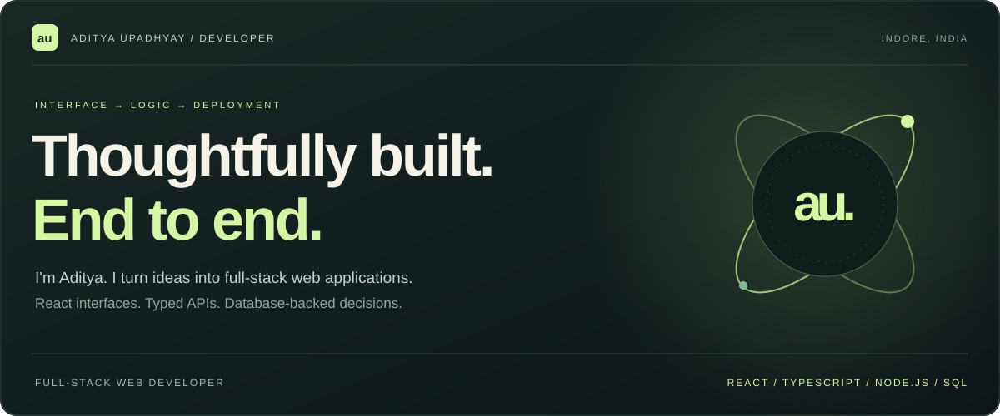
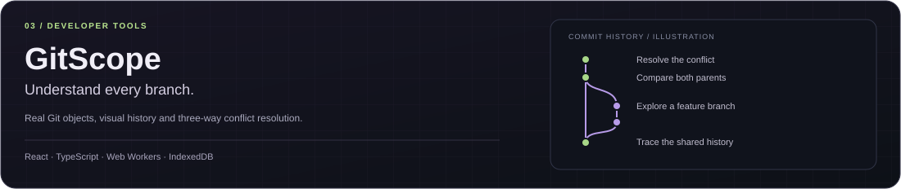
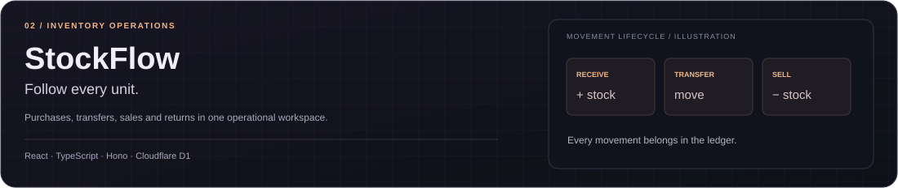
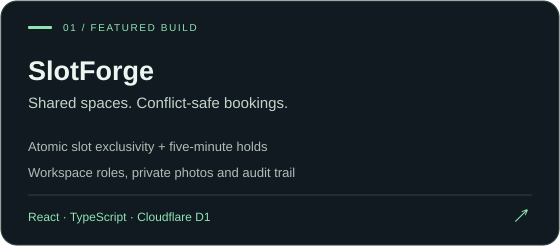

### A little context

I'm **Aditya**, a full-stack developer working with **React, TypeScript, Node.js and NestJS**. My work spans client-facing applications and product teams, with an interest in the parts that make software dependable: clear interfaces, explicit permissions and consistent data.

Currently a **Full Stack Developer at BlueBricks Technologies**. Previously **Pod Ceres Lead at Vosyn**, with earlier development experience at **Kodrish** and **Infotact**.

---

### Selected work

Three applications, three different engineering problems. Explore the live products, then follow the implementation in their repositories.

**[Launch GitScope ↗](https://aadi90392.github.io/gitscope/)** &nbsp; / &nbsp; [Source code](https://github.com/aadi90392/gitscope) &nbsp; / &nbsp; [Architecture & boundaries](https://github.com/aadi90392/gitscope#architecture)

<b>Inside GitScope — Git objects, workers and persistence</b>

- **Real repository operations:** commits, branches, staging and merges through isomorphic-git.
- **Three-way resolution:** inspect base, current and incoming versions before producing a merge commit.
- **Responsive processing:** Git operations run in a Web Worker; LightningFS persists objects in IndexedDB.
- **Reload reliability:** filesystem writes are flushed before completed operations are acknowledged.
- **Deliberate boundary:** local repositories; no remote push/clone. History rewrite tools are explicitly simulations.

[Read the implementation and verification approach →](https://github.com/aadi90392/gitscope#verification)

 

**[Launch StockFlow ↗](https://stockflow.aditya-upadhyay1-dev.workers.dev/)** &nbsp; / &nbsp; [Source code](https://github.com/aadi90392/stockflow) &nbsp; / &nbsp; [Project overview](https://portfolio.aditya-upadhyay1-dev.workers.dev/#stockflow)

<b>Inside StockFlow — connect operations to inventory</b>

- **One workspace:** products, suppliers, locations and team access.
- **Connected operations:** purchases, receiving, transfers, sales and returns.
- **Traceable changes:** a stock ledger helps explain inventory movements.
- **Deployment:** a React interface and Hono API on Cloudflare, backed by D1.
- **Deliberate boundary:** inventory operations, not shipment tracking or a complete accounting suite.

 

**[Launch SlotForge ↗](https://slotforge.aditya-upadhyay1-dev.workers.dev/)** &nbsp; / &nbsp; [Source code](https://github.com/aadi90392/slotforge) &nbsp; / &nbsp; [Project overview](https://portfolio.aditya-upadhyay1-dev.workers.dev/#slotforge)

<b>Inside SlotForge — protect a booking beyond the button</b>

- **Membership-based access:** workspace roles and booking ownership are checked on the backend.
- **Competing reservations:** database constraints protect the booking rules.
- **Safe retries:** idempotency handling keeps repeated requests from becoming duplicate operations.
- **Account lifecycle:** email verification, recovery and revocable sessions.
- **Deliberate boundary:** physical room reservations, not a video meeting service.

---

### From the team room

| Team | Role | Focus |
| :--- | :--- | :--- |
| **BlueBricks Technologies** · Jul 2026–present | Full Stack Developer | NestJS / Next.js product features, technical evaluations and performance investigation |
| **Vosyn** · Jan–Jun 2026 | Junior Software Developer · Pod Ceres Lead | React / Node.js delivery, pull-request reviews and cross-team quality |
| **Kodrish** · Jan 2025–Jan 2026 | Web Developer | Client-facing MERN applications, REST APIs and deployment |
| **Infotact** · Sep–Nov 2024 | Associate Lead Developer · Intern | Team delivery and MongoDB schema improvements |

[Explore responsibilities and outcomes on my portfolio →](https://portfolio.aditya-upadhyay1-dev.workers.dev/#experience)

### Tools, with a purpose

| Interface | Application | Data & delivery |
| :--- | :--- | :--- |
| React · Next.js · TypeScript | Node.js · NestJS · Express · Hono | MongoDB · SQL · Cloudflare D1 |
| HTML · CSS · Tailwind · Monaco | REST APIs · JWT · RBAC | Git · GitHub Actions · Cloudflare |
| Zustand · D3 | Web Workers · IndexedDB | Vitest · Playwright · Postman |

### What I care about

**01 / Clarity** — Make the next action understandable, including loading, empty and error states.  
**02 / Correctness** — Validate inputs and enforce important rules where the data changes.  
**03 / Evidence** — Show the implementation, test meaningful behavior and document the boundaries.

 

<a href="https://portfolio.aditya-upadhyay1-dev.workers.dev/">Portfolio</a> &nbsp; · &nbsp; <a href="https://www.linkedin.com/in/adityaupadhyay-tech/">LinkedIn</a> &nbsp; · &nbsp; <a href="mailto:adi375461@gmail.com">Email</a>

