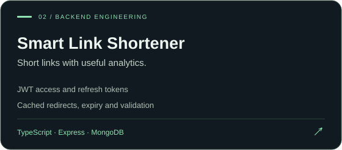
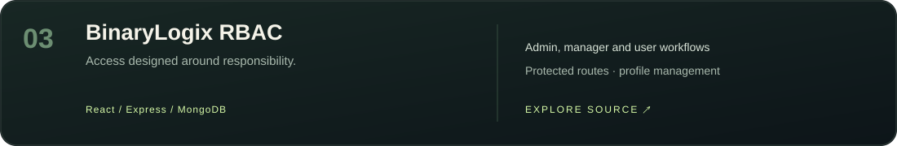
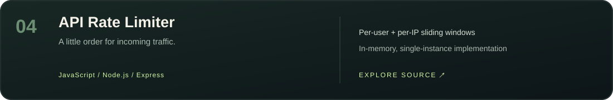

  

  
  
  
  

### A little about me

I'm **Aditya**, a full-stack web developer based in **Indore, India**. I work with React, TypeScript and the MERN stack, building interfaces backed by authentication, APIs and databases.

My current focus is **SlotForge**: a deployed workspace-booking app where permissions, conflicting requests and reservation changes are handled on the server. I enjoy working through the details that make an application dependable after the first click.

### Selected work

<table>
<tr>
<td width="50%"> <a href="https://slotforge.aditya-upadhyay1-dev.workers.dev">Live application ↗</a> · <a href="https://github.com/aadi90392/slotforge">Source & architecture ↗</a></td>
<td width="50%"> <a href="https://github.com/aadi90392/smart-link-shortener">API documentation & source ↗</a></td>
</tr>
<tr>
<td width="50%"> <a href="https://github.com/aadi90392/BinaryLogix-RBAC">Explore role-based workflows ↗</a></td>
<td width="50%"> <a href="https://github.com/aadi90392/Rate-Limiter">Explore the implementation ↗</a></td>
</tr>
</table>

### My development toolkit

| Frontend | Backend & data | Tools & deployment |
| :--- | :--- | :--- |
| React · TypeScript · JavaScript | Node.js · Express · REST APIs | Git · GitHub Actions · Postman |
| HTML · CSS · Tailwind CSS · Vite | MongoDB · SQL · Cloudflare D1 | Cloudflare Workers · Vercel |

### What I care about when building

**01 — Clear interfaces.** Useful empty states, readable forms and feedback that tells people what happened.

**02 — Backend correctness.** Validate input, check permissions and enforce important rules in the database.

**03 — Changes I can verify.** Tests, documented trade-offs and a working deployment alongside the source.

<b>Inside SlotForge's engineering</b>

- Partial SQL unique index prevents competing reservations from occupying the same slot.
- Short-lived holds, idempotent retries and conflict-safe rescheduling.
- Revocable cookie sessions, email verification and single-use password recovery.
- Tenant-scoped data access, owner/member permissions and transactional booking audits.
- Local integration checks include 50 concurrent requests for one slot; this tests correctness, not production throughput.

[Read the architecture and current boundaries →](https://github.com/aadi90392/slotforge#data-integrity)

---

<b>Have something useful to build?</b> Let's talk about the interface, the API and everything in between. <a href="mailto:adi375461@gmail.com">adi375461@gmail.com</a> · <a href="https://www.linkedin.com/in/adityaupadhyay-tech/">LinkedIn</a>

