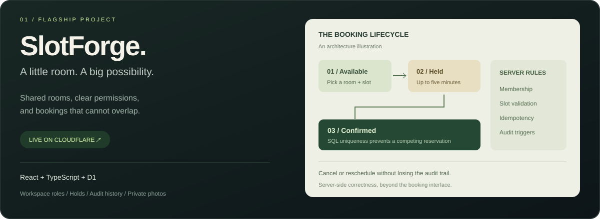

### The person behind the code

I'm **Aditya Upadhyay**, a full-stack web developer working with **React, TypeScript and the MERN stack**. I like turning a useful idea into an application people can actually navigate, sign into and use.

Currently building **SlotForge**, with a focus on the details behind the interface: workspace permissions, conflicting booking requests, account recovery and a dependable data model.

 

<a href="https://slotforge.aditya-upadhyay1-dev.workers.dev"><b>Open live app ↗</b></a> &nbsp; · &nbsp; <a href="https://github.com/aadi90392/slotforge"><b>Read the source ↗</b></a> &nbsp; · &nbsp; <a href="https://github.com/aadi90392/slotforge#data-integrity"><b>Architecture & trade-offs ↗</b></a>

<b>Behind the interface — engineering decisions</b>

- **Conflicts belong in the database:** a partial unique index prevents two active bookings for the same room and time.
- **Retries should be safe:** idempotency keys reuse an existing booking; rescheduling preserves the original reservation if the target is unavailable.
- **Access follows membership:** workspace roles, private room photos and booking ownership are checked on the backend.
- **Accounts have a lifecycle:** verified email, revocable sessions, single-use recovery links and account deletion.
- **Correctness is tested:** local integration tests include 50 competing requests for one slot. This is a correctness check, not a production throughput claim.

[Read current product boundaries and deployment checks →](https://github.com/aadi90392/slotforge/blob/main/docs/RELEASE-STATUS.md)

 

### The toolkit

| Interfaces | APIs & data | Shipping & verification |
| :--- | :--- | :--- |
| **React · TypeScript · JavaScript** | **Node.js · Express · REST APIs** | **Git · GitHub Actions · Postman** |
| HTML · CSS · Tailwind CSS · Vite | MongoDB · SQL · Cloudflare D1 | Cloudflare Workers · Vercel |

### How I approach a build

| 01 / Make it clear | 02 / Make it correct | 03 / Make it verifiable |
| :--- | :--- | :--- |
| Readable interfaces, useful empty states and feedback that explains what happened. | Validate inputs, enforce permissions and protect important rules in the database. | Test meaningful cases, document limitations and ship a working deployment. |

 

<a href="mailto:adi375461@gmail.com">adi375461@gmail.com</a> &nbsp; / &nbsp; <a href="https://www.linkedin.com/in/adityaupadhyay-tech/">LinkedIn</a> &nbsp; / &nbsp; <a href="https://aditya-portfolio-eta-cyan.vercel.app">Portfolio</a>

